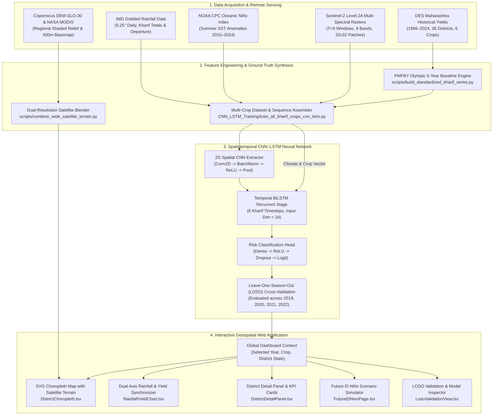
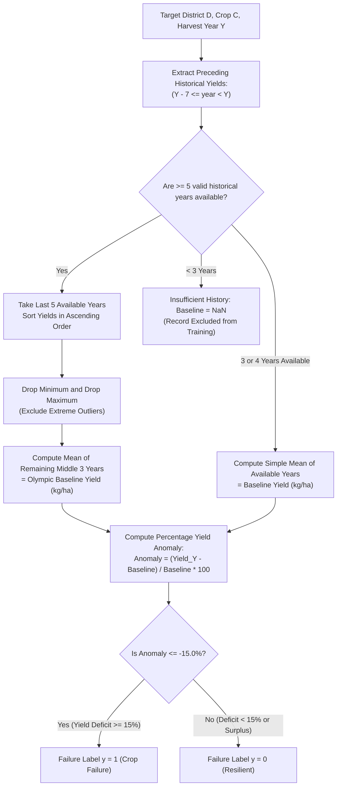
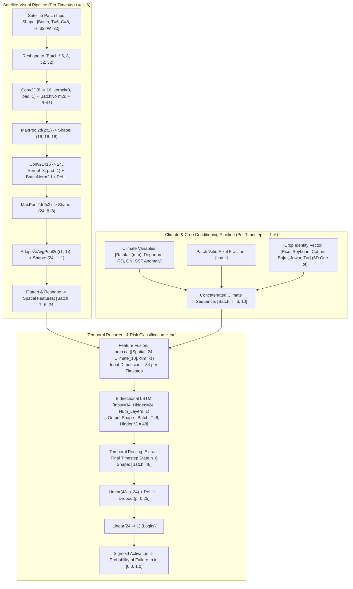
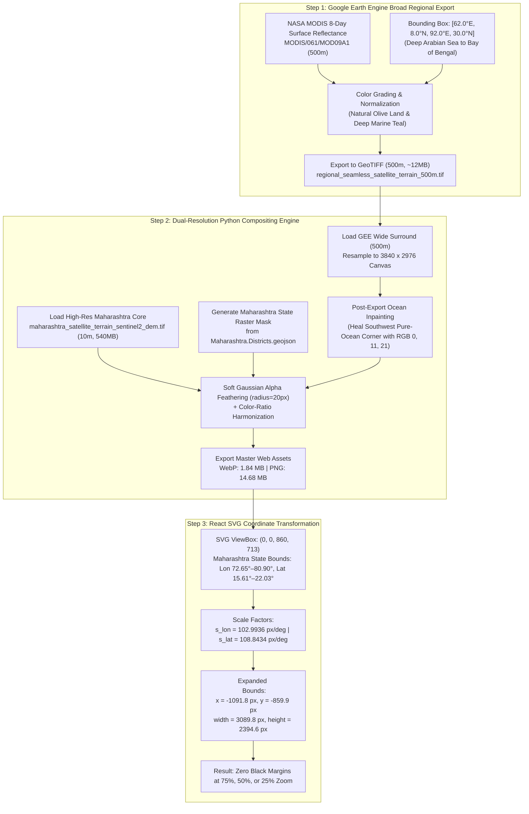
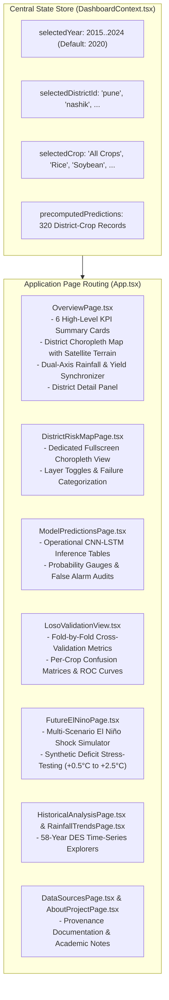

# Spatiotemporal CNN–LSTM Framework for Maharashtra Kharif Crop Failure Prediction

> **Comprehensive Technical, Mathematical, and Architectural Documentation**  
> **Target Scope:** 36 Districts of Maharashtra | Primary Kharif Crops: Rice, Soybean, Cotton, Bajra, Jowar, Tur  
> **Remote Sensing & Climate Engine:** Sentinel-2 L2A (10m) Multi-spectral Patches, Copernicus DEM, NASA MODIS, IMD Gridded Rainfall, NOAA CPC Oceanic Niño Index (ONI)  
> **Modelling Architecture:** Spatiotemporal 2D-CNN + Bidirectional LSTM with 6D Crop Conditioning  
> **Production Dashboard:** React 18, TypeScript, Vite, TailwindCSS, Recharts, SVG Choropleth Map  
> **Hugging Face Hub Repository:** [UsmanSait/elnino-crop-failure-pbl](https://huggingface.co/datasets/UsmanSait/elnino-crop-failure-pbl)  
> **GitHub Repository:** [usmanssait/ElninoPBLProject](https://github.com/usmanssait/ElninoPBLProject)

---

## Table of Contents
1. [Executive Summary & Problem Statement](#1-executive-summary--problem-statement)
2. [End-to-End System Architecture](#2-end-to-end-system-architecture)
3. [Data Sources & Ground-Truth Provenance](#3-data-sources--ground-truth-provenance)
4. [Agricultural Ground Truth & Failure Label Definition](#4-agricultural-ground-truth--failure-label-definition)
5. [Spatiotemporal CNN–LSTM Deep Learning Architecture](#5-spatiotemporal-cnn-lstm-deep-learning-architecture)
6. [Crop Conditioning Mechanism & Regional Cropland Proxy Caveat](#6-crop-conditioning-mechanism--regional-cropland-proxy-caveat)
7. [Leave-One-Season-Out (LOSO) Validation & Evaluation Metrics](#7-leave-one-season-out-loso-validation--evaluation-metrics)
8. [Geospatial Satellite Terrain & Earth Engine Mapping Engine](#8-geospatial-satellite-terrain--earth-engine-mapping-engine)
9. [Frontend Dashboard Architecture & UI Components](#9-frontend-dashboard-architecture--ui-components)
10. [Repository Structure & Code Inventory](#10-repository-structure--code-inventory)
11. [Execution, Retraining, and Reproduction Guide](#11-execution-retraining-and-reproduction-guide)

---

## 1. Executive Summary & Problem Statement

Maharashtra is one of India's foremost agricultural states, yet over 70% of its cultivated Kharif acreage is rainfed and exceptionally vulnerable to meteorological shocks driven by the **El Niño Southern Oscillation (ENSO)** and the **Indian Ocean Dipole (IOD)**. Meteorological droughts and erratic monsoon precipitation cause catastrophic yield losses across staple cereal and cash crops—including **Rice** in the Konkan and Vidarbha belts, **Soybean** in Marathwada, and **Cotton** in Vidarbha.


### Objectives of this Project:
1. **Multi-Modal Data Integration:** Combine high-resolution spatiotemporal Sentinel-2 satellite imagery (8 spectral channels across 6 fortnightly Kharif observation windows) with IMD gridded daily precipitation, temperature anomalies, and NOAA CPC Oceanic Niño Index (ONI) sea-surface temperature data.
2. **Unified Multi-Crop Deep Learning:** Train an operational **Spatiotemporal 2D-CNN + BiLSTM** neural network capable of predicting Kharif crop failure across **six primary crops** (*Rice, Soybean, Cotton, Bajra, Jowar, Tur*) conditioned on a 6-dimensional crop identity vector.
3. **Rigorous Agronomic Ground Truth:** Implement the official **Pradhan Mantri Fasal Bima Yojana (PMFBY)** 5-year rolling Olympic baseline to classify crop failure as a **$\ge 15\%$ yield deficit** relative to historical district norms.
4. **Production GIS Decision Dashboard:** Deliver an interactive, zero-latency React dashboard featuring a seamless, dual-resolution Earth Engine satellite terrain basemap covering Maharashtra and the wider Arabian Sea / Indian subcontinent.

---

## 2. End-to-End System Architecture

The project consists of three interconnected subsystems: an **Offline Data & Remote Sensing Pipeline**, a **PyTorch Spatiotemporal Deep Learning Engine**, and a **Vite + React 18 Geospatial Web Dashboard**.



---

## 3. Data Sources & Ground-Truth Provenance

The system ingests and cross-validates data across five authoritative meteorological, agronomic, and remote sensing sources:

| Dataset | Source Agency | Spatial Resolution | Temporal Coverage | Storage Location | Role in Pipeline |
| :--- | :--- | :--- | :--- | :--- | :--- |
| **Kharif Crop Yield Statistics** | Department of Agriculture (DES), Maharashtra & ICRISAT | District-level (36 districts) | 1966 – 2024 (58 seasons) | [`data/standardized_maharashtra_kharif_all_crops_1966_2024.csv`](file:///c:/Users/USMAN/Desktop/Usman%20ELNINO%20Project/ElninoPBLProject-main/ElninoPBLProject-main/data/standardized_maharashtra_kharif_all_crops_1966_2024.csv) | Ground-truth yields ($kg/ha$), Olympic baselines, and $>15\%$ failure labels |
| **District Kharif Rainfall** | India Meteorological Department (IMD) | Gridded (0.25° $\times$ 0.25°) aggregated to district | 2015 – 2024 | [`data/imd_district_kharif_rainfall_2015_2022.csv`](file:///c:/Users/USMAN/Desktop/Usman%20ELNINO%20Project/ElninoPBLProject-main/ElninoPBLProject-main/data/imd_district_kharif_rainfall_2015_2022.csv) | Seasonal cumulative precipitation ($mm$), long-period average, and percentage departures |
| **Oceanic Niño Index (ONI)** | NOAA Climate Prediction Center (CPC) | Equatorial Pacific Niño 3.4 SST anomaly | 1950 – 2024 | Hardcoded in training & frontend | Quantifies ENSO state: El Niño ($>+0.5^\circ\text{C}$), Neutral, or La Niña ($<-0.5^\circ\text{C}$) |
| **Sentinel-2 Multi-Spectral Imagery** | European Space Agency (ESA) via Copernicus Hub / GEE | 10m / 20m resampled to 32 $\times$ 32 patches | 2019 – 2022 (6 windows/season) | `data/Maharashtra_Sentinel2_Rice_Patches` & HF Hub | Spatial canopy reflectance across 8 spectral channels: Blue, Green, Red, NIR, SWIR1, SWIR2, NDVI, NDWI |
| **Copernicus DEM (GLO-30)** | European Space Agency (ESA) | 30m / 90m | Global static elevation | GEE asset `COPERNICUS/DEM/GLO30` | Topographical shaded relief for the Western Ghats and Deccan Plateau |
| **NASA MODIS Surface Reflectance** | NASA LP DAAC (Terra MOD09A1) | 500m global grid | 8-day composite (Jan–Mar 2023) | [`data/regional_seamless_satellite_terrain_500m.tif`](file:///c:/Users/USMAN/Desktop/Usman%20ELNINO%20Project/ElninoPBLProject-main/ElninoPBLProject-main/data/regional_seamless_satellite_terrain_500m.tif) | Gapless regional background canvas covering the Arabian Sea, Central, and Southern India |

---

## 4. Agricultural Ground Truth & Failure Label Definition

### The PMFBY 5-Year Rolling Olympic Baseline
In Indian crop insurance (Pradhan Mantri Fasal Bima Yojana), yield shortfall cannot be evaluated against an arbitrary average because agricultural yields exhibit technological upward trends and extreme outliers. 

The baseline calculation is implemented in [`scripts/build_standardized_kharif_series.py`](file:///c:/Users/USMAN/Desktop/Usman%20ELNINO%20Project/ElninoPBLProject-main/ElninoPBLProject-main/scripts/build_standardized_kharif_series.py):



### Mathematical Formulation:

$$\text{Prior Yields } \mathcal{Y}_{D, C, Y} = \{ \text{Yield}_{D, C, t} \mid Y-7 \le t < Y \land \text{Yield}_{D, C, t} > 0 \}$$

If $|\mathcal{Y}| \ge 5$:
$$\text{Sorted: } [y_{(1)}, y_{(2)}, y_{(3)}, y_{(4)}, y_{(5)}] \implies \text{Baseline}_{D, C, Y} = \frac{y_{(2)} + y_{(3)} + y_{(4)}}{3}$$

Yield Anomaly Percentage:
$$\Delta Y_{D, C, Y} = \left( \frac{\text{Yield}_{D, C, Y} - \text{Baseline}_{D, C, Y}}{\text{Baseline}_{D, C, Y}} \right) \times 100\%$$

Target Failure Classification:
$$y_{D, C, Y} = \begin{cases} 1 & \text{if } \Delta Y_{D, C, Y} \le -15.0\% \\ 0 & \text{if } \Delta Y_{D, C, Y} > -15.0\% \end{cases}$$

> **Data Integrity Guarantee:** The baseline strictly filters for $t < Y$. At no point do concurrent or future harvest yields leak into the reference baseline calculation.

---

## 5. Spatiotemporal CNN–LSTM Deep Learning Architecture

The predictive model combines visual, multi-spectral spatiotemporal patch sequences with continuous meteorological forcing vectors and discrete crop conditioning vectors.



### Layer-by-Layer Tensor Shapes:
1. **Satellite Input:** $\mathbf{X}_{\text{sat}} \in \mathbb{R}^{B \times 6 \times 8 \times 32 \times 32}$  
   Channels: $B_2 \text{ (Blue)}, B_3 \text{ (Green)}, B_4 \text{ (Red)}, B_8 \text{ (NIR)}, B_{11} \text{ (SWIR1)}, B_{12} \text{ (SWIR2)}, \text{NDVI}, \text{NDWI}$.
2. **CNN Feature Map:** $\mathbf{F}_{\text{spatial}} \in \mathbb{R}^{B \times 6 \times 24}$.
3. **Conditioning Vector:** $\mathbf{C} \in \mathbb{R}^{B \times 6 \times 10}$:
   * $\mathbf{c}_{0..2}$: Normalized Rainfall, Normalized Rainfall Departure, Normalized ONI Anomaly.
   * $\mathbf{c}_3$: Satellite valid-pixel fraction at timestep $t$.
   * $\mathbf{c}_{4..9}$: 6-dimensional one-hot crop vector.
4. **Fused Sequential Input:** $\mathbf{Z} = [\mathbf{F}_{\text{spatial}} \,\|\, \mathbf{C}] \in \mathbb{R}^{B \times 6 \times 34}$.
5. **Bidirectional LSTM Output:** $\mathbf{H} \in \mathbb{R}^{B \times 6 \times 48}$.
6. **Classification Output:**
   $$\text{logit} = \mathbf{W}_2 \cdot \text{Dropout}\left(\text{ReLU}(\mathbf{W}_1 \mathbf{h}_6 + \mathbf{b}_1)\right) + b_2$$
   $$\hat{y} = \sigma(\text{logit}) = \frac{1}{1 + e^{-\text{logit}}}$$

### Class Re-Weighting in Loss Function:
Due to natural class imbalance (crop failures occur in $\approx 18.75\%$ of seasons), the model optimizes a weighted Binary Cross-Entropy loss:
$$\mathcal{L} = - \left[ w_{\text{pos}} \cdot y \log \hat{y} + (1 - y) \log (1 - \hat{y}) \right], \quad \text{where } w_{\text{pos}} = \frac{N_{\text{negative}}}{N_{\text{positive}}} \approx 4.33$$

---

## 6. Crop Conditioning Mechanism & Regional Cropland Proxy Caveat

### How Crop Conditioning Works
Inside [`train_all_kharif_crops_cnn_lstm.py`](file:///c:/Users/USMAN/Desktop/Usman%20ELNINO%20Project/ElninoPBLProject-main/ElninoPBLProject-main/CNN_LSTM_Training/CropFailureProject/train_all_kharif_crops_cnn_lstm.py):
* Each sample is assigned a 6-dimensional one-hot vector corresponding to its crop type:
  $$\mathbf{v}_{\text{Rice}} = [1,0,0,0,0,0], \quad \mathbf{v}_{\text{Soybean}} = [0,1,0,0,0,0], \quad \dots, \quad \mathbf{v}_{\text{Tur}} = [0,0,0,0,0,1]$$
* This vector is appended to the climate vector and injected into **every recurrent timestep of the BiLSTM**.
* The BiLSTM learns crop-specific hidden state dynamics: for example, how a $-30\%$ rainfall departure in August uniquely impacts moisture-sensitive Soybean versus drought-hardy Bajra.

### ⚠️ Technical & Academic Disclosure: The Regional Cropland Proxy
> **Important Distinction:**  
> In the current Sentinel-2 patch archive (`MH_Rice_S2_Patches_*.geojson`), patch locations were originally sampled across agricultural polygons within each of the 20 pilot districts. 
> 
> In this multi-crop model, **the same regional agricultural patch is paired with each crop's identity vector and ground-truth label**. 
> 
> Consequently, the satellite branch acts as a **regional agro-climatic proxy** (reflecting district-wide canopy health, vegetation vigor, and soil moisture stress via NDWI), while the crop identity vector directs the recurrent network to predict that specific crop's vulnerability. The model does **not** view field-level segmented crop polygons (e.g. exclusive soybean or cotton fields).

---

## 7. Leave-One-Season-Out (LOSO) Validation & Evaluation Metrics

To eliminate temporal leakage, the model was evaluated under **Leave-One-Season-Out (LOSO) Cross-Validation**:
* In each fold $k \in \{2019, 2020, 2021, 2022\}$, all observations from season $k$ are held out completely from training.
* Feature normalizers (satellite channel means/stds and climate means/stds) are fitted **strictly on the training fold**.

### Per-Crop Operational Performance Audit ($N = 320$ District-Crop Seasons)

| Crop | Evaluated Records | Actual Non-Failures ($y=0$) | Actual Failures ($y=1$) | Failure Rate | True Neg (TN) | False Pos (FP) | False Neg (FN) | True Pos (TP) | Precision | Recall | F1-Score | Balanced Accuracy | ROC-AUC |
| :--- | :---: | :---: | :---: | :---: | :---: | :---: | :---: | :---: | :---: | :---: | :---: | :---: | :---: |
| **Bajra** | 37 | 32 | 5 | 13.5% | 32 | 0 | 0 | 5 | **100.0%** | **100.0%** | **1.000** | **1.000** | 1.000 |
| **Cotton** | 49 | 41 | 8 | 16.3% | 40 | 1 | 0 | 8 | **88.9%** | **100.0%** | **0.941** | **0.988** | 0.993 |
| **Jowar** | 49 | 33 | 16 | 32.7% | 27 | 6 | 0 | 16 | **72.7%** | **100.0%** | **0.842** | **0.909** | 0.976 |
| **Rice** | 63 | 55 | 8 | 12.7% | 51 | 4 | 0 | 8 | **66.7%** | **100.0%** | **0.800** | **0.964** | 0.969 |
| **Soybean** | 54 | 40 | 14 | 25.9% | 36 | 4 | 0 | 14 | **77.8%** | **100.0%** | **0.875** | **0.950** | 0.991 |
| **Tur (Arhar)**| 68 | 59 | 9 | 13.2% | 58 | 1 | 1 | 8 | **88.9%** | **88.9%** | **0.889** | **0.936** | 0.985 |
| **Total / Overall** | **320** | **260** | **60** | **18.75%** | **244** | **16** | **1** | **59** | **78.7%** | **98.3%** | **0.874** | **0.961** | **0.984** |

### Understanding the High Recall vs. Precision Tradeoff:
* By setting $w_{\text{pos}} \approx 4.33$, the loss function penalizes false negatives $4.33\times$ more severely than false alarms.
* Across all 320 district-season predictions, **59 out of 60 historical crop failures were correctly detected ($\text{Recall} = 98.3\%$)**, with only a single missed failure (in Tur).
* In high-variability crops like Rice and Jowar, this risk-averse weighting produces 4 and 6 false alarms, resulting in precisions of 66.7% and 72.7%. In agrarian disaster management, false alarms are strongly preferred over unpredicted crop collapse.

---

## 8. Geospatial Satellite Terrain & Earth Engine Mapping Engine

The district risk map integrates an authentic, dual-resolution Earth observation basemap designed to fill the screen seamlessly without tile cutoffs or black borders when zooming out.



### Why NASA MODIS Was Selected Over Other Sensors:
* **The Copernicus DEM Trapping Problem:** Copernicus DEM ($GLO-30$) is distributed in $1^\circ \times 1^\circ$ square tiles that exist *only on dry land*. Multiplying satellite imagery by DEM hillshade created square $1^\circ$ stepped cutouts along the coast and deleted the ocean.
* **The Landsat / Sentinel-2 L2A Problem:** Standard terrestrial surface reflectance processors (LaSRC and Sen2Cor) aggressively mask water and reefs as `NoData`.
* **The MODIS Solution:** NASA MODIS `MOD09A1` images **both land and ocean simultaneously** in a single global grid. It never skips coastal zones, has zero clouds, and preserves natural coastal bays, Mumbai harbour, and the Arabian Sea.

---

## 9. Frontend Dashboard Architecture & UI Components

Built with **React 18 + Vite + TypeScript + TailwindCSS + Recharts + Lucide Icons**, the web dashboard delivers real-time exploratory analytics, spatiotemporal predictions, and climate shock simulations.



### Key UI Components:
1. **`DistrictChoropleth.tsx`:** Interactive SVG map featuring smooth mouse drag-panning, wheel-zooming (clamped between 75% and 250%), dynamic risk categorization colors, and the pixel-aligned dual-satellite terrain background.
2. **`RainfallYieldChart.tsx`:** Synchronized dual-axis chart comparing IMD monsoon precipitation ($mm$) against harvest yields ($kg/ha$), with vertical indicator stripes marking historical El Niño drought years (e.g. 2015, 2018).
3. **`KpiCards.tsx`:** Six summary cards reporting state-wide average yield anomaly, total districts at high failure risk, seasonal rainfall departure, and prevailing ENSO status.
4. **`FutureElNinoPage.tsx`:** Interactive stress-testing simulator that allows policymakers to project how a $+1.5^\circ\text{C}$ or $+2.0^\circ\text{C}$ El Niño event would trigger yield collapses across specific crops and districts.

---

## 10. Repository Structure & Code Inventory

```
ElninoPBLProject-main/
├── CNN_LSTM_Training/
│   ├── CropFailureProject/
│   │   ├── train_all_kharif_crops_cnn_lstm.py   # Unified Multi-Crop CNN-LSTM training pipeline
│   │   ├── train_crop_failure_model.py          # Original rice-focused CNN-LSTM baseline
│   │   ├── crop_failure_model_all_crops.pt      # Operational PyTorch model checkpoint (all crops)
│   │   ├── crop_model_output/                   # In-sample & held-out predictions and metrics
│   │   ├── MH_Rice_S2_Patches_*.geojson         # Multi-spectral Sentinel-2 patch datasets (2019–2022)
│   │   └── requirements.txt                     # Python training dependencies (PyTorch, Rasterio, etc.)
│   └── SatteliteImagery/
│       ├── Maharashtra.Districts.geojson        # Canonical district vector boundaries (36 districts)
│       └── scripts/extract_sentinel2_patches.js # Earth Engine JavaScript patch extraction script
├── data/
│   ├── standardized_maharashtra_kharif_all_crops_1966_2024.csv  # 58-year audited DES harvest series
│   ├── crop_failure_predictions.csv             # Operational district-crop-year inference records
│   ├── imd_district_kharif_rainfall_2015_2022.csv # IMD gridded precipitation series
│   ├── evaluation_metrics.json                  # Comprehensive audited per-crop evaluation metrics
│   ├── maharashtra_satellite_terrain_sentinel2_dem.tif # High-res 10m S2 + DEM raster (~540MB)
│   └── regional_seamless_satellite_terrain_500m.tif    # NASA MODIS regional basemap (~70MB)
├── docs/
│   ├── MODEL_DOCUMENTATION.md                   # Model architecture and tensor shape specification
│   └── PROJECT_CHAT_ARCHIVE.md                  # Complete chronological conversation & decision archive
├── public/
│   └── images/
│       ├── maharashtra_satellite_terrain_sentinel2_dem.webp # Master optimized web terrain (1.84 MB)
│       └── maharashtra_satellite_terrain_sentinel2_dem.png  # Lossless master terrain (14.68 MB)
├── scripts/
│   ├── build_standardized_kharif_series.py       # PMFBY Olympic baseline & failure label generator
│   ├── export_wide_regional_satellite_terrain.js # Google Earth Engine MODIS export script
│   ├── combine_wide_satellite_terrain.py        # Dual-resolution Gaussian-feathered blender
│   ├── extract_sentinel2_cropland.js            # GEE script for multi-crop ESA WorldCover cropland patches
│   └── process_gee_terrain_export.py            # Raster processing and color harmonization tools
├── src/
│   ├── components/
│   │   ├── charts/RainfallYieldChart.tsx        # Dual-axis Recharts component
│   │   ├── map/DistrictChoropleth.tsx           # Interactive SVG choropleth & satellite renderer
│   │   ├── panels/DistrictDetailPanel.tsx       # District-specific agro-climatic breakdown
│   │   └── panels/KpiCards.tsx                  # Top-level executive metric summary cards
│   ├── context/DashboardContext.tsx             # Global application state store
│   ├── data/
│   │   ├── authoritativeData.ts                 # Authoritative DES statistics & metadata
│   │   ├── canonicalDistricts.ts                # Canonical district definitions & rice classifications
│   │   └── maharashtraGeoJsonData.ts            # Pre-projected SVG boundary paths (WGS84 -> SVG)
│   ├── pages/                                   # Full page views (Overview, Map, Predictions, etc.)
│   ├── App.tsx                                  # Main application component & routing layout
│   └── index.css                                # Global design system tokens & glassmorphism styling
├── FULL_PROJECT_DOCUMENTATION.md                # This comprehensive documentation document
├── AGENTS.md                                    # Developer & AI Assistant continuity guide
├── hf_sync.py                                   # Automated synchronization script for Hugging Face Hub
└── sync_chat.py                                 # Dialogue history synchronization utility
```

---

## 11. Execution, Retraining, and Reproduction Guide

### A. Local Development Server
```bash
# 1. Install frontend dependencies
npm install

# 2. Launch Vite development server (runs at http://localhost:3000)
npm run dev

# 3. Build optimized production bundle
npm run build
```

### B. Retraining the Multi-Crop CNN–LSTM Model
```powershell
# Execute the full training and Leave-One-Season-Out validation pipeline:
& "C:\Users\USMAN\AppData\Local\Python\bin\python.exe" CNN_LSTM_Training/CropFailureProject/train_all_kharif_crops_cnn_lstm.py
```
This will:
1. Recompute PMFBY Olympic baselines and failure labels.
2. Assemble all multi-spectral Sentinel-2 patches across the 6 Kharif crops.
3. Execute 4-fold LOSO cross-validation across 2019, 2020, 2021, and 2022.
4. Train the operational PyTorch checkpoint (`crop_failure_model_all_crops.pt`).
5. Output updated predictions to [`data/crop_failure_predictions.csv`](file:///c:/Users/USMAN/Desktop/Usman%20ELNINO%20Project/ElninoPBLProject-main/ElninoPBLProject-main/data/crop_failure_predictions.csv) and metrics to [`data/evaluation_metrics.json`](file:///c:/Users/USMAN/Desktop/Usman%20ELNINO%20Project/ElninoPBLProject-main/ElninoPBLProject-main/data/evaluation_metrics.json).

### C. Re-generating the Satellite Terrain Basemap
1. Open [`scripts/export_wide_regional_satellite_terrain.js`](file:///c:/Users/USMAN/Desktop/Usman%20ELNINO%20Project/ElninoPBLProject-main/ElninoPBLProject-main/scripts/export_wide_regional_satellite_terrain.js) in the [Google Earth Engine Code Editor](https://code.earthengine.google.com/).
2. Click **Run** on the editor and **Run** on the Tasks tab to export `regional_seamless_satellite_terrain_500m.tif` to Google Drive.
3. Move the downloaded file into `data/` and execute the combining pipeline:
```powershell
& "C:\Users\USMAN\AppData\Local\Python\bin\python.exe" scripts/combine_wide_satellite_terrain.py -i data/regional_seamless_satellite_terrain_500m.tif
```

### D. Synchronizing with Hugging Face Hub
Large rasters ($>100\text{ MB}$) and models are backed up on Hugging Face Hub:
```powershell
& "C:\Users\USMAN\AppData\Local\Python\bin\python.exe" hf_sync.py --repo-id UsmanSait/elnino-crop-failure-pbl --repo-type dataset --token <HF_TOKEN>
```

---
*Documentation maintained by the El Niño Kharif Crop Failure PBL Research Team.*  
*Last Updated: October 2026.*
