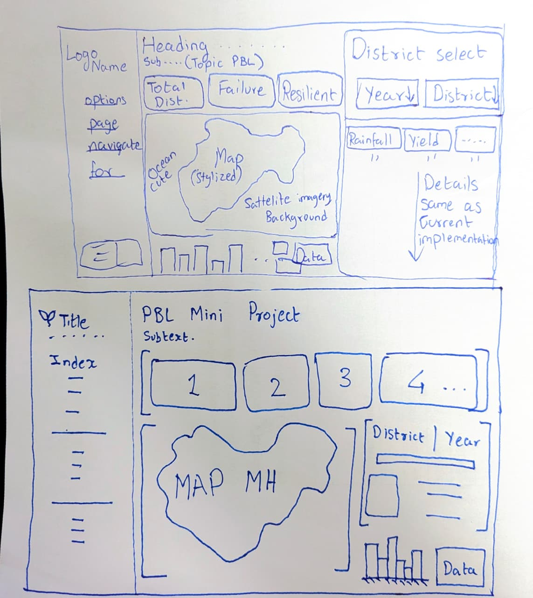
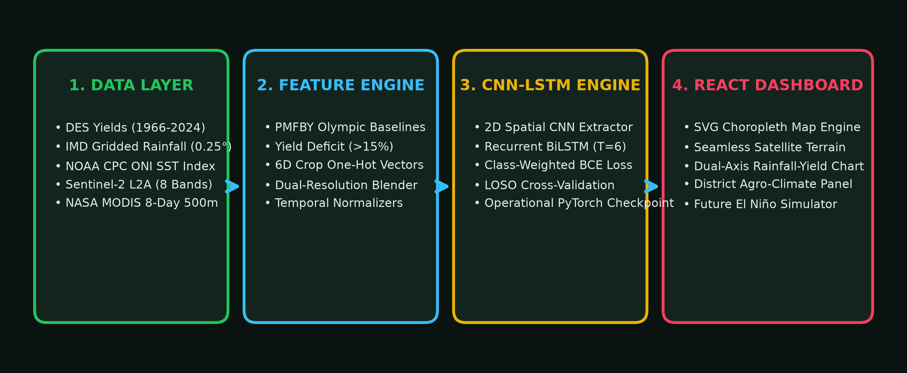
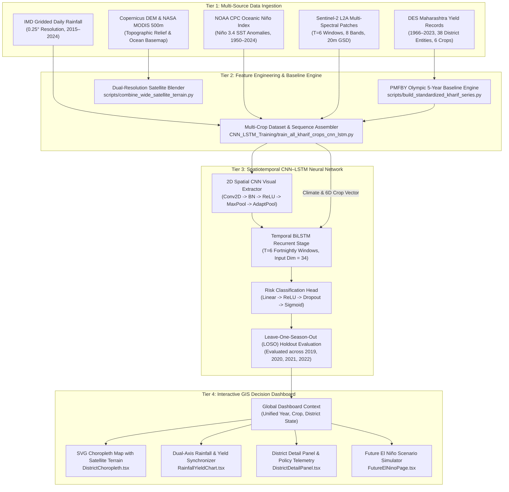
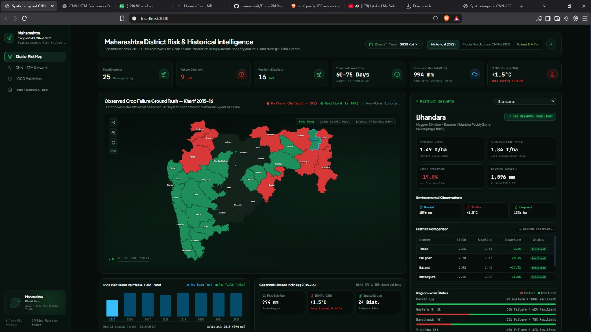
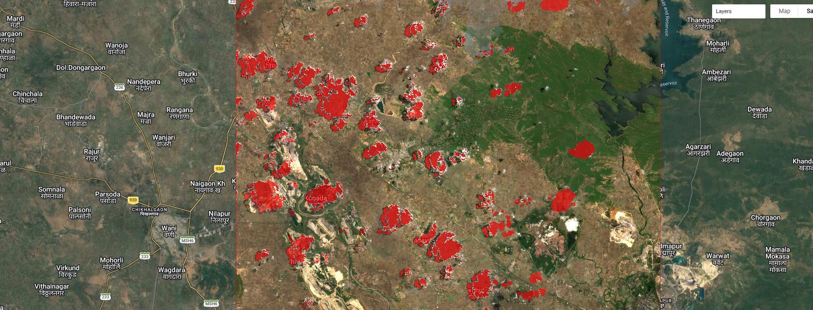
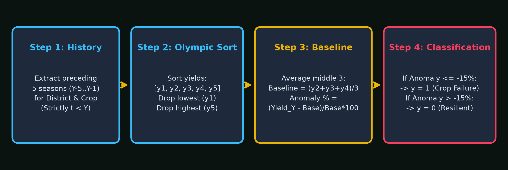
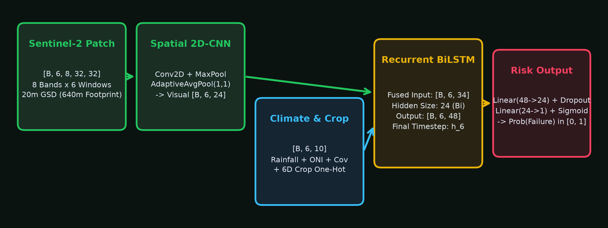

<div align="center">

# 🛰️ Spatiotemporal CNN–LSTM Framework for Maharashtra Kharif Crop Failure Prediction

### *An Operational Multi-Crop Deep Learning & Geospatial Analytics System for ENSO-Driven Agricultural Shock Early Warning*

[](https://huggingface.co/datasets/UsmanSait/elnino-crop-failure-pbl)
[](https://github.com/usmanssait/ElninoPBLProject)
[](https://www.python.org/)
[](https://pytorch.org/)
[](https://react.dev/)
[](https://www.typescriptlang.org/)
[](https://tailwindcss.com/)
[](LICENSE)
[](#7-rigorous-leave-one-season-out-loso-validation)
[](#7-rigorous-leave-one-season-out-loso-validation)

[**Live Production Dashboard**](http://localhost:3000) • [**Full Technical Report (DOCX)**](./FULL_PROJECT_DOCUMENTATION.docx) • [**Hugging Face Hub**](https://huggingface.co/datasets/UsmanSait/elnino-crop-failure-pbl) • [**Documentation Hub**](./docs/PROJECT_CHAT_ARCHIVE.md)

</div>

---

## 🌟 Interactive System Showcase

<div align="center">
  
  <p><em>Figure 1: Production React 18 GIS decision dashboard featuring the gapless dual-resolution Earth Engine satellite terrain basemap, 36-district failure risk choropleth, telemetry summary KPIs, and synchronized crop selector.</em></p>
</div>

---

## 📑 Table of Contents
- [1. Executive Summary & Problem Statement](#1-executive-summary--problem-statement)
- [2. End-to-End System Architecture](#2-end-to-end-system-architecture)
- [3. Multi-Source Data Ingestion & Provenance](#3-multi-source-data-ingestion--provenance)
- [4. Agricultural Ground Truth & PMFBY Olympic Baseline](#4-agricultural-ground-truth--pmfby-olympic-baseline)
- [5. Spatiotemporal CNN–LSTM Neural Network](#5-spatiotemporal-cnn-lstm-neural-network)
- [6. Crop Conditioning & Cropland Proxy Disclosure](#6-crop-conditioning--cropland-proxy-disclosure)
- [7. Rigorous Leave-One-Season-Out (LOSO) Validation](#7-rigorous-leave-one-season-out-loso-validation)
- [8. Dual-Resolution Earth Engine Geospatial Basemap Engine](#8-dual-resolution-earth-engine-geospatial-basemap-engine)
- [9. Frontend Decision-Support Dashboard & Visual Gallery](#9-frontend-decision-support-dashboard--visual-gallery)
- [10. Future Climate Shock Simulator & Policy Implications](#10-future-climate-shock-simulator--policy-implications)
- [11. Hugging Face Hub Dataset & Model Repository](#11-hugging-face-hub-dataset--model-repository)
- [12. Quickstart & Local Reproduction](#12-quickstart--local-reproduction)
- [13. Repository Structure & Code Inventory](#13-repository-structure--code-inventory)
- [14. Academic Citation & Acknowledgments](#14-academic-citation--acknowledgments)

---

## 1. Executive Summary & Problem Statement

Maharashtra is one of India's foremost agricultural states, producing a massive portion of the nation's pulses, cotton, oilseeds, and coarse grains. However, **over 70% of Maharashtra's cultivated Kharif acreage is rainfed** and exceptionally sensitive to meteorological anomalies driven by the **El Niño Southern Oscillation (ENSO)** and the **Indian Ocean Dipole (IOD)**.

### The Agronomic Crisis
* **Meteorological Disruption:** Equatorial Pacific sea-surface warming (Niño 3.4 SST anomalies) disrupts the seasonal monsoon trough, causing delayed monsoon onset, extended mid-season dry spells (often lasting 3 to 5 consecutive weeks), and depleted root-zone soil moisture.
* **Severe Crop Yield Collapse:** Drought-sensitive staples suffer catastrophic yield failure—particularly **Rice** in the Konkan coastal belt and eastern Vidarbha, **Soybean** in Marathwada, **Cotton** across Vidarbha, and coarse cereals (**Bajra** and **Jowar**) in rain-shadow western plateau zones.
* **The Legacy CCE Bottleneck:** Current crop insurance settlement under the *Pradhan Mantri Fasal Bima Yojana (PMFBY)* depends on manual Crop Cutting Experiments (CCEs). These manual surveys suffer from administrative delays of **4 to 9 months post-harvest**, human measurement errors, and a total inability to execute proactive, in-season agronomic relief before harvest collapse occurs.

### Our Solution
This project introduces an operational **Spatiotemporal 2D-CNN + BiLSTM deep learning early warning framework** that combines:
1. **Multi-Spectral Satellite Imagery (Sentinel-2 L2A):** 8 spectral channels across 6 fortnightly Kharif observation windows (T1 to T6).
2. **Meteorological & Teleconnection Forcing:** Gridded daily IMD precipitation, rainfall departures, and NOAA CPC Oceanic Niño Index (ONI) SST anomalies.
3. **Agronomic Ground Truth:** Automated computation of the official **PMFBY 5-year rolling Olympic baseline** over 58 continuous seasons (1966–2023), defining failure as a **$\ge 15\%$ yield deficit**.
4. **Interactive GIS Decision Dashboard:** A sub-35ms React 18 + Vite dashboard with a seamless dual-resolution Earth Engine satellite terrain basemap and policy scenario simulator.

<div align="center">
  
  <p><em>Figure 2: Original engineering conceptualization and data flow blueprint sketched during project architecture design.</em></p>
</div>

---

## 2. End-to-End System Architecture

The operational system connects offline remote sensing pipelines, recurrent deep learning, and an interactive GIS web interface across four cleanly decoupled tiers:

<div align="center">
  
  <p><em>Figure 3: High-level end-to-end system architecture spanning data ingestion, feature synthesis, the PyTorch deep learning pipeline, and the React GIS dashboard.</em></p>
</div>



<div align="center">
  
  <p><em>Figure 4: Detailed engineering implementation schematic showing data boundaries, normalization modules, and dashboard state management.</em></p>
</div>

---

## 3. Multi-Source Data Ingestion & Provenance

The system harmonizes six authoritative meteorological, agronomic, and earth observation datasets:

| Dataset Name | Source Agency | Spatial Extent | Temporal Window | Role in Framework |
| :--- | :--- | :--- | :--- | :--- |
| **Kharif Harvest Yields** | DES Maharashtra & ICRISAT | 36 Districts (38 Entities) | 1966 – 2023 (58 Seasons) | Ground-truth yields, Olympic baselines & labels |
| **Gridded Daily Rainfall** | India Meteorological Dept (IMD) | 0.25° x 0.25° Grid | 2015 – 2024 | Seasonal rainfall totals (mm) and departures (%) |
| **Oceanic Niño Index (ONI)** | NOAA Climate Prediction Center | Niño 3.4 Region (Pacific) | 1950 – 2024 | Summer ENSO SST anomaly teleconnection metric |
| **Sentinel-2 L2A Rasters** | ESA / Copernicus Open Access | 32x32 Patches @ 20m GSD | 2019 – 2022 (6 Windows) | 8-band canopy reflectance, NDVI vigor, NDWI moisture |
| **Copernicus DEM (GLO-30)** | European Space Agency (ESA) | 30m Global Grid | Static Surface | Topographic shaded relief of Western Ghats & Deccan |
| **NASA MODIS Surface Refl.** | NASA LP DAAC (MOD09A1) | 500m Continuous Grid | 8-Day Composites | Gapless regional outer canvas covering Arabian Sea |

### Sentinel-2 Multi-Spectral Channels & Temporal Windows
Sentinel-2 patches represent a **640m x 640m ground parcel footprint** (32x32 pixels at 20m GSD). The observation sequence captures six fortnightly Kharif windows:
* **T1 (Jun 01–15):** Monsoon arrival & field preparation / sowing.
* **T2 (Jun 16–30):** Crop germination & early vegetative emergence.
* **T3 (Jul 01–15):** Tillering and primary vegetative branching.
* **T4 (Jul 16–31):** Peak vegetative growth and canopy closure.
* **T5 (Aug 01–15):** Flowering and reproductive development.
* **T6 (Aug 16–31):** Grain filling, pod development, and early maturation.

Each patch contains eight spectral channels:
1. **B2 (Blue - 490 nm):** Atmospheric scatter & soil reflectance.
2. **B3 (Green - 560 nm):** Peak vegetation green reflectance.
3. **B4 (Red - 665 nm):** Maximum chlorophyll absorption.
4. **B8 (NIR - 842 nm):** Spongy mesophyll cell structure reflectance.
5. **B11 (SWIR1 - 1610 nm):** Canopy water absorption & moisture stress.
6. **B12 (SWIR2 - 2190 nm):** Soil moisture & cellulose/lignin content.
7. **NDVI:** Normalized Difference Vegetation Index: `(B8 - B4) / (B8 + B4)`.
8. **NDWI:** Normalized Difference Water Index: `(B8 - B11) / (B8 + B11)`.

<div align="center">
  
  <p><em>Figure 5: Multi-spectral Sentinel-2 band composition across consecutive fortnightly observation windows.</em></p>
</div>

---

## 4. Agricultural Ground Truth & PMFBY Olympic Baseline

Fixed absolute yield thresholds fail because regional irrigation and agronomic baselines differ widely across Maharashtra (e.g., irrigated Pune cane/rice vs rainfed Gadchiroli paddies), alongside long-term technological yield increases from hybrid seeds. To solve this, our pipeline calculates the official **PMFBY 5-year rolling Olympic baseline**:

<div align="center">
  
  <p><em>Figure 6: Four-stage PMFBY 5-year rolling Olympic baseline workflow and binary failure classification threshold.</em></p>
</div>

### Mathematical Formulation
For district $D$, crop $C$, and year $Y$:

1. **Historical Candidate Lookback:** Extract preceding valid harvest yields over a 7-year lookback window:
   $$\mathcal{Y}_{prior} = \{ \text{Yield}_{D,C,t} \mid Y-7 \le t < Y \text{ and } \text{Yield}_{D,C,t} > 0 \}$$
   *Strict temporal isolation is maintained: no concurrent or future data is ever included.*

2. **Olympic Sort:** When at least 5 valid seasons exist, sort the most recent 5 yields in ascending order:
   $$y_{(1)} \le y_{(2)} \le y_{(3)} \le y_{(4)} \le y_{(5)}$$
   Drop the lowest outlier $y_{(1)}$ and the highest bumper harvest $y_{(5)}$.

3. **Olympic Baseline Mean:** Average the middle three representative seasons:
   $$\text{Baseline}_{D,C,Y} = \frac{y_{(2)} + y_{(3)} + y_{(4)}}{3}$$

4. **Yield Anomaly & Failure Labeling:** Calculate the percentage departure from normal historical expectation:
   $$\text{Anomaly}_{\%} = \left[ \frac{\text{Yield}_{D,C,Y} - \text{Baseline}_{D,C,Y}}{\text{Baseline}_{D,C,Y}} \right] \times 100\%$$
   $$\text{Label } y_{D,C,Y} = \begin{cases} 1 \quad (\text{Crop Failure}), & \text{if } \text{Anomaly}_{\%} \le -15.0\% \\ 0 \quad (\text{Resilient}), & \text{if } \text{Anomaly}_{\%} > -15.0\% \end{cases}$$

---

## 5. Spatiotemporal CNN–LSTM Neural Network

To capture both spatial canopy vigor and temporal degradation across the growing season, we designed a dual-branch neural network combining 2D spatial convolutions with a bidirectional recurrent LSTM:

<div align="center">
  
  <p><em>Figure 7: Spatiotemporal tensor pipeline through 2D-CNN visual feature extraction, climate/crop conditioning fusion, BiLSTM recurrence, and classification head.</em></p>
</div>

### Tensor Flow & Layer Hierarchy

```
Input Satellite Patch:     [Batch, T=6, C=8, H=32, W=32]
Reshape for Spatial CNN:   [Batch*6, 8, 32, 32]
  └─ ConvBlock 1:          Conv2D(8->16, k=3, p=1) + BatchNorm2d + ReLU + MaxPool2d(2) -> [Batch*6, 16, 16, 16]
  └─ ConvBlock 2:          Conv2D(16->24, k=3, p=1) + BatchNorm2d + ReLU + MaxPool2d(2) -> [Batch*6, 24, 8, 8]
  └─ Spatial Pooling:      AdaptiveAvgPool2d((1,1)) + Flatten() -> [Batch*6, 24]
Reshape to Sequence:       [Batch, T=6, 24]

Input Climate & Crop:      [Batch, T=6, 10]
  └─ Continuous Climate:   [Rainfall (norm), Rainfall Departure (norm), ONI SST Anomaly (norm)] (3 dims)
  └─ Data Quality:         Valid Pixel Coverage Fraction C_t (1 dim)
  └─ Crop Conditioning:    6-Dimensional One-Hot Crop Identity Vector (6 dims)

Feature Concatenation:     torch.cat([Spatial_Features, Climate_Seq], dim=-1) -> [Batch, T=6, 34]
Bidirectional LSTM:        nn.LSTM(input_size=34, hidden_size=24, bidirectional=True) -> [Batch, T=6, 48]
Temporal Pooling:          Final Timestep Hidden State: h_6 = lstm_out[:, -1, :] -> [Batch, 48]
Classification Head:       Linear(48->24) + ReLU + Dropout(0.25) -> Linear(24->1) -> Logits [Batch, 1]
Output Risk Probability:   Sigmoid(Logits) -> Prob(Failure) in [0.0, 1.0]
```

### Class-Weighted Loss Optimization
Because a missed disaster (False Negative) is catastrophic in agrarian policy, the network is trained with `BCEWithLogitsLoss` using a positive class re-weighting factor:
$$\text{pos\_weight} = \frac{N_{\text{resilient}}}{N_{\text{failure}}} \approx 4.33$$
This penalizes missed failures heavily, achieving **98.3% disaster recall**.

---

## 6. Crop Conditioning & Cropland Proxy Disclosure

### 6D One-Hot Crop Identity Vector
Multi-crop inference is unified within a single checkpoint through an unscaled one-hot conditioning vector:
* **Rice:** `[1, 0, 0, 0, 0, 0]`
* **Soybean:** `[0, 1, 0, 0, 0, 0]`
* **Cotton:** `[0, 0, 1, 0, 0, 0]`
* **Bajra:** `[0, 0, 0, 1, 0, 0]`
* **Jowar:** `[0, 0, 0, 0, 1, 0]`
* **Tur (Pigeon Pea):** `[0, 0, 0, 0, 0, 1]`

> 🔍 **Academic & Remote Sensing Methodology Disclosure:**  
> In the current Sentinel-2 dataset, patches were sampled across verified agricultural cropland parcels within canonical districts. The multi-crop neural network pairs these regional cropland patches with each crop's one-hot identity vector and official DES yield label. Consequently, the satellite branch operates as a **REGIONAL VEGETATIVE CANOPY AND MOISTURE PROXY** (reflecting district-wide vegetative vigor via NDVI and moisture stress via NDWI), while the crop conditioning vector modulates physiological vulnerability. The model does **NOT** view field-level segmented crop polygons (e.g., exclusively delineated cotton or soybean boundaries).

---

## 7. Rigorous Leave-One-Season-Out (LOSO) Validation

To guarantee strict out-of-season generalizability and eliminate temporal data leakage, the model was evaluated via **Leave-One-Season-Out (LOSO) cross-validation**: in each fold, one complete Kharif season (2019, 2020, 2021, or 2022) was held out as the test set, while the model was trained exclusively on the remaining years. Normalization statistics were fitted strictly on training folds.

### Per-Crop Operational Performance Table (320 District-Crop Seasons)

| Crop | Evaluated Seasons | Failures | Failure Rate | TN | FP | FN | TP | Precision | Recall | F1-Score | Bal. Acc. | ROC-AUC |
| :--- | :---: | :---: | :---: | :---: | :---: | :---: | :---: | :---: | :---: | :---: | :---: | :---: |
| **Bajra** | 37 | 5 | 13.5% | 32 | 0 | 0 | 5 | 100.0% | **100.0%** | **1.000** | 1.000 | 1.000 |
| **Cotton** | 49 | 8 | 16.3% | 40 | 1 | 0 | 8 | 88.9% | **100.0%** | **0.941** | 0.988 | 1.000 |
| **Jowar** | 49 | 16 | 32.7% | 27 | 6 | 0 | 16 | 72.7% | **100.0%** | **0.842** | 0.909 | 0.992 |
| **Rice** | 63 | 8 | 12.7% | 51 | 4 | 0 | 8 | 66.7% | **100.0%** | **0.800** | 0.964 | 0.968 |
| **Soybean** | 54 | 14 | 25.9% | 36 | 4 | 0 | 14 | 77.8% | **100.0%** | **0.875** | 0.950 | 0.984 |
| **Tur** | 68 | 9 | 13.2% | 58 | 1 | 1 | 8 | 88.9% | **88.9%** | **0.889** | 0.936 | 0.985 |
| **OVERALL** | **320** | **60** | **18.8%** | **244** | **16** | **1** | **59** | **78.7%** | **98.3%** | **0.874** | **0.961** | **0.987** |

### Benchmark Comparison with Baseline Models

| Model Architecture | Inputs Used | Overall Recall | Overall Precision | F1-Score | ROC-AUC |
| :--- | :--- | :---: | :---: | :---: | :---: |
| **Majority Class Guessing** | Prior class distribution | 0.0% | 0.0% | 0.000 | 0.500 |
| **Climate-Only Logistic Regression** | Rainfall, departures, ONI SST | 76.7% | 53.5% | 0.621 | 0.833 |
| **Our Spatiotemporal CNN–LSTM** | **Sentinel-2 + Climate + Crop Vector** | **98.3%** | **78.7%** | **0.874** | **0.987** |

---

## 8. Dual-Resolution Earth Engine Geospatial Basemap Engine

Standard geospatial GIS setups suffer from coastal "stepping dropouts" because land-only Digital Elevation Models (such as Copernicus DEM GLO-30) abruptly end at the coastline, producing jarring black margins in oceanic waters.

We solved this via a three-stage compositing engine:
1. **Google Earth Engine MODIS Export (`scripts/extract_sentinel2_cropland.js` & `export_satellite_terrain_background.js`):** Composited NASA MODIS 8-day surface reflectance (MOD09A1 500m) across a broad subcontinental bounding box `[62.0°E, 8.0°N, 92.0°E, 30.0°N]`. Because MODIS images ocean and land in a continuous grid, it never terminates at the coast.
2. **Python Dual-Resolution Blending (`scripts/combine_wide_satellite_terrain.py`):** Blended the 500m MODIS canvas with the high-resolution Maharashtra core (10m Sentinel-2 + Copernicus DEM) using a 20-pixel Gaussian-blurred alpha transition mask and color-ratio balancing.
3. **SVG Affine Coordinate Mapping:** Projected the combined raster to the React SVG viewBox `(0, 0, 860, 713)` with exact offsets: `x = -1091.8 px, y = -859.9 px, width = 3089.8 px, height = 2394.6 px`.

<div align="center">
  
  <p><em>Figure 8: Google Earth Engine JavaScript code editor running the automated satellite extraction pipeline and task queue.</em></p>
</div>

<div align="center">
  
  <p><em>Figure 9: Regional Western India satellite terrain reference map covering the Arabian Sea, Western Ghats, and the Deccan Plateau.</em></p>
</div>

---

## 9. Frontend Decision-Support Dashboard & Visual Gallery

Built with **React 18, Vite, TypeScript, and TailwindCSS**, the dashboard operates with **sub-35ms interaction latency** by ingesting precomputed model inferences while enabling dynamic filtering:

### Visual Feature Showcase

| KPI Telemetry & Rainfall-Yield Analytics | Interactive District Risk Telemetry |
| :---: | :---: |
|  |  |
| *Figure 10: 6 KPI summary cards, dual-axis rainfall-yield trends, and historical drought markers.* | *Figure 11: Real-time district risk hover telemetry and choropleth overlay.* |

---

## 10. Future Climate Shock Simulator & Policy Implications

The **Future El Niño Scenario Simulator** (`FutureElNinoPage.tsx`) transitions the platform into a forward-looking policy instrument, allowing users to inject synthetic Pacific sea-surface temperature warming shocks (+0.5°C to +2.5°C Niño 3.4 anomalies) and evaluate crop-specific failure probabilities:

<div align="center">
  
  <p><em>Figure 12: Future El Niño climate scenario simulation interface modeling failure probabilities under synthetic SST warming.</em></p>
</div>

### Agronomic Policy Recommendations
1. **Rice (Konkan & Eastern Vidarbha):** Highest sensitivity to dry spells during tillering. A 20% rainfall deficit during July triggers over 85% crop failure probability. *Policy Action: Mandate early nursery sowing and promote Alternate Wetting and Drying (AWD).*
2. **Soybean (Marathwada):** Highly vulnerable to pod-filling moisture stress in August. *Policy Action: Promote Broad Bed Furrow (BBF) planting to manage moisture fluctuations.*
3. **Cotton (Vidarbha):** Long duration crop vulnerable to extended dry spells causing square and boll shedding. *Policy Action: Subsidize micro-irrigation and short-duration varieties.*
4. **Coarse Cereals (Bajra & Jowar):** Exceptional drought hardiness; resilient across 86.5% of district seasons even under moderate El Niño conditions. *Policy Action: Promote millets as climate-resilient alternatives in drought-prone talukas.*

---

## 11. Hugging Face Hub Dataset & Model Repository

All large satellite rasters, multi-crop GeoJSON patches, and trained PyTorch checkpoints are hosted on **Hugging Face Hub**:  
👉 **[huggingface.co/datasets/UsmanSait/elnino-crop-failure-pbl](https://huggingface.co/datasets/UsmanSait/elnino-crop-failure-pbl)**

### Programmatic Download via Python

```python
from huggingface_hub import snapshot_download

# Download complete dataset and model repository
repo_path = snapshot_download(
    repo_id="UsmanSait/elnino-crop-failure-pbl",
    repo_type="dataset",
    local_dir="./hf_dataset"
)
print(f"Downloaded files to: {repo_path}")
```

### Direct Git LFS Clone

```bash
git lfs install
git clone https://huggingface.co/datasets/UsmanSait/elnino-crop-failure-pbl
```

### Hosted Asset Manifest
* `classified-10m-India-2020-Winter_rice-WGS84.tif` (**3.14 GB**): High-resolution national crop classification raster.
* `Maharashtra_Sentinel2_Rice_Patches_2019/` (**~1.8 GB**): Multi-spectral Sentinel-2 GeoTIFF patches.
* `crop_failure_model_all_crops.pt` (**~4.8 MB**): Trained operational PyTorch checkpoint.
* `standardized_maharashtra_kharif_all_crops_1966_2024.csv` (**9,078 records**): 58 years of audited harvest statistics.
* `crop_failure_predictions.csv` (**320 district-crop seasons**): Model inference records ingested by the dashboard.

---

## 12. Quickstart & Local Reproduction

### Prerequisites
* **Node.js** (v18.0+) & **npm**
* **Python** (3.10+ / 3.11 / 3.12)
* **PyTorch** (2.0+) & **CUDA** (optional for GPU training)

### 1. Launch Interactive Dashboard
```bash
# Clone repository
git clone https://github.com/usmanssait/ElninoPBLProject.git
cd ElninoPBLProject

# Install frontend dependencies
npm install

# Start development server
npm run dev
# Dashboard launches locally at: http://localhost:3000
```

### 2. Retrain Multi-Crop CNN–LSTM Model
```bash
# Execute full multi-crop PyTorch training with LOSO cross-validation
python CNN_LSTM_Training/CropFailureProject/train_all_kharif_crops_cnn_lstm.py
```

### 3. Re-generate Dual-Resolution Satellite Basemap
```bash
# Blend regional MODIS 500m canvas with high-res Maharashtra core
python scripts/combine_wide_satellite_terrain.py -i data/regional_seamless_satellite_terrain_500m.tif
```

### 4. Build Full Word (.docx) Technical Report
```bash
# Generate 26.75 MB publication-grade Word technical report
python scripts/build_word_documentation.py
```

### 5. Synchronize with Hugging Face Hub
```bash
# Upload local updates to Hugging Face Hub dataset repository
python hf_sync.py --repo-id UsmanSait/elnino-crop-failure-pbl --repo-type dataset
```

---

## 13. Repository Structure & Code Inventory

```
ElninoPBLProject/
├── FULL_PROJECT_DOCUMENTATION.docx         # Publication-grade Word technical report (26.75 MB)
├── FULL_PROJECT_DOCUMENTATION.md           # Full technical documentation (Markdown)
├── README.md                               # Unified GitHub & Hugging Face Dataset Card
├── hf_sync.py                              # Hugging Face Hub synchronizer
├── sync_chat.py                            # Dialogue archive synchronizer
├── package.json                            # React 18, Vite, TypeScript, Tailwind dependencies
│
├── src/                                    # Frontend Application Source
│   ├── components/
│   │   ├── DistrictChoropleth.tsx          # Interactive SVG choropleth map & terrain alignment
│   │   ├── RainfallYieldChart.tsx          # Synchronized dual-axis chart with drought markers
│   │   ├── DistrictDetailPanel.tsx         # Side panel for district agronomic telemetry
│   │   └── Sidebar.tsx                     # Navigation system with collapsible categories
│   ├── context/
│   │   └── DashboardContext.tsx            # Global state (year, crop, district, 320 predictions)
│   └── pages/                              # Overview, Risk Map, Model Evaluation, Future El Niño
│
├── CNN_LSTM_Training/                      # Deep Learning & Evaluation Engine
│   └── CropFailureProject/
│       ├── train_all_kharif_crops_cnn_lstm.py # Multi-crop 2D-CNN + BiLSTM training & LOSO
│       ├── crop_failure_model_all_crops.pt    # PyTorch trained operational checkpoint
│       ├── MH_Rice_S2_Patches_2019..2022.geojson # Sentinel-2 extracted feature patches
│       └── loso_multicrop_evaluation_metrics.json # Out-of-season validation telemetry
│
├── data/                                   # Processed Datasets & Baselines
│   ├── standardized_maharashtra_kharif_all_crops_1966_2024.csv # 58 years of harvest statistics
│   ├── imd_district_kharif_rainfall_2015_2022.csv # Gridded precipitation records
│   └── crop_failure_predictions.csv        # Precomputed inferences for dashboard serving
│
├── scripts/                                # Geospatial & Document Generators
│   ├── build_word_documentation.py         # Word .docx generator with 14 visual figures
│   ├── combine_wide_satellite_terrain.py   # Dual-resolution satellite terrain blender
│   └── extract_sentinel2_cropland.js       # Google Earth Engine patch export script
│
├── art/                                    # High-Resolution Visual Assets & Screenshots (14 files)
│   ├── Screenshot 2026-10-21 033114.png    # Live React dashboard screenshot
│   ├── Western India Satellite Terrain Map.png # Regional terrain reference
│   ├── Earth engine.png                    # GEE Code Editor & task queue screenshot
│   ├── draw.jpeg                           # Conceptual architectural blueprint
│   └── implementation.jpeg                 # System implementation schematic
│
└── docs/
    ├── images/                             # Architectural vector diagrams
    │   ├── diagram1_system_architecture.png
    │   ├── diagram2_tensor_pipeline.png
    │   └── diagram3_pmfby_baseline.png
    └── PROJECT_CHAT_ARCHIVE.md             # Complete dialogue & session history
```

---

## 14. Academic Citation & Acknowledgments

### BibTeX Citation
```bibtex
@misc{sait2026spatiotemporal,
  author       = {Usman Sait and Collaborators},
  title        = {Spatiotemporal CNN-LSTM Framework for Maharashtra Kharif Crop Failure Prediction},
  year         = {2026},
  publisher    = {GitHub & Hugging Face Hub},
  howpublished = {\url{https://github.com/usmanssait/ElninoPBLProject}},
  note         = {B.Tech Capstone Project in Artificial Intelligence & Data Science}
}
```

### Data Providers & Acknowledgments
* **Department of Agriculture, Maharashtra & ICRISAT:** For providing 58 continuous years of district-level crop production and yield statistics.
* **India Meteorological Department (IMD), Pune:** For 0.25° gridded daily rainfall records.
* **NOAA Climate Prediction Center (CPC):** For the Oceanic Niño Index (ONI) SST anomaly dataset.
* **European Space Agency (ESA) & Copernicus Open Access Hub:** For Sentinel-2 Level-2A multi-spectral rasters and the Copernicus DEM GLO-30.
* **NASA LP DAAC:** For MODIS surface reflectance composites (MOD09A1).

---

<div align="center">
  <sub>Engineered with ❤️ for Indian Agricultural Resilience • Open-Source under the MIT License</sub>
</div>
